# Android / Web visual parity

Reference: Android Kotlin screens and the checked-in `app/src/test/screenshots` and `docs/verification` images. Final browser captures use WebKit at 393×852, in light, dark and Arabic; pure component fixtures use a 360px CSS width and identical Amber data. The checked-in native post-card bitmap is 320px wide, so those fixtures are not pixel-aligned comparisons. No pixel-equality claim is made. These are actual renders, not mockups.

## Side-by-side references

Android is on the left, WebKit on the right. Device references include Android status/navigation bars; browser captures show the app viewport.

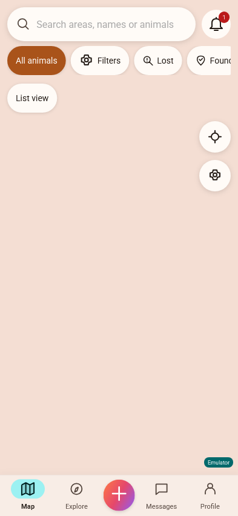

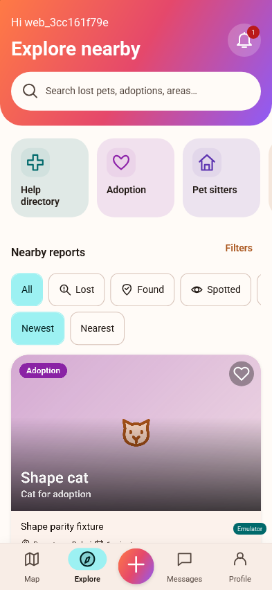

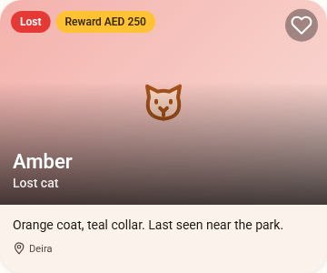

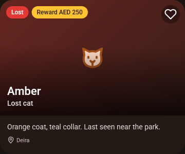

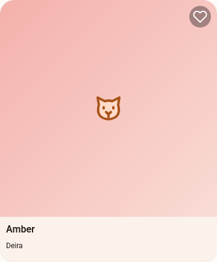

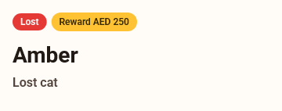

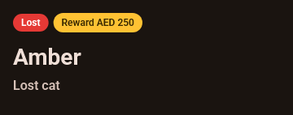

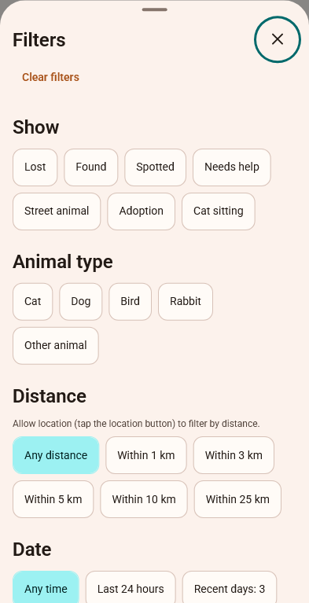

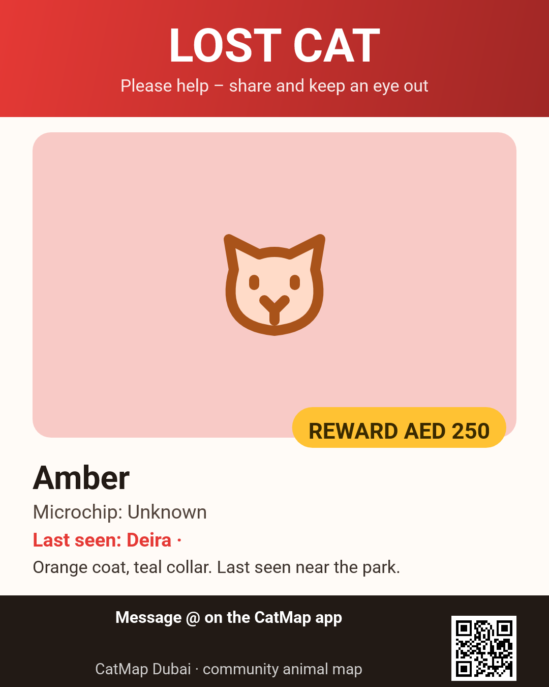

## Chooser and wizard

The reference behavior and fields are documented from `PostEditorScreen.kt`, its view model and the Android chooser in `docs/android-screen-reference.md`. There is no checked-in isolated Android chooser/editor screenshot; do not imply a matching bitmap exists. The generated WebKit sequence is:

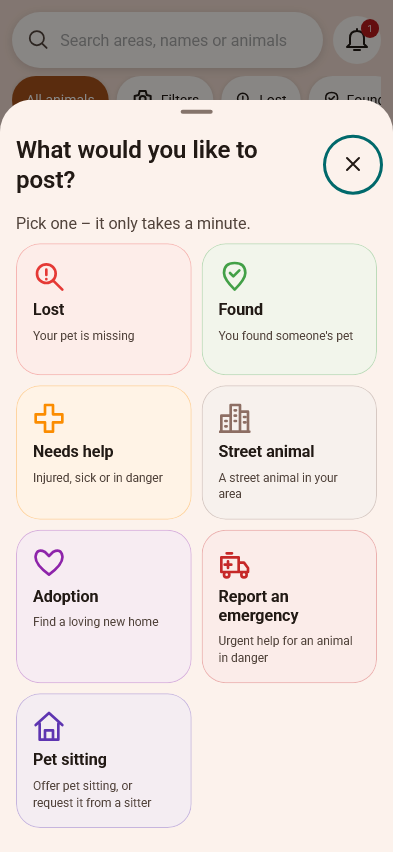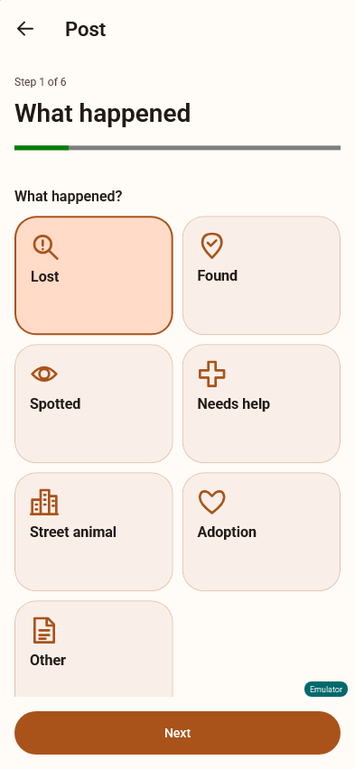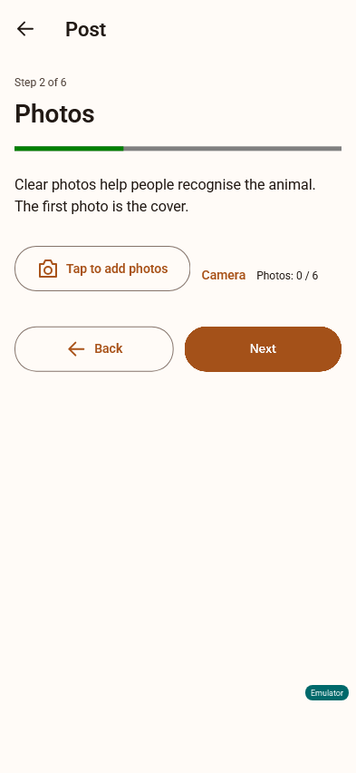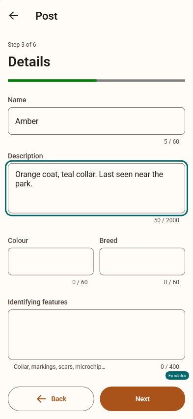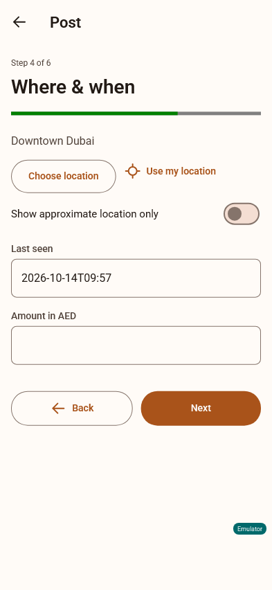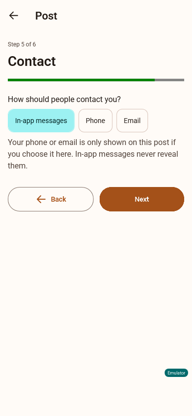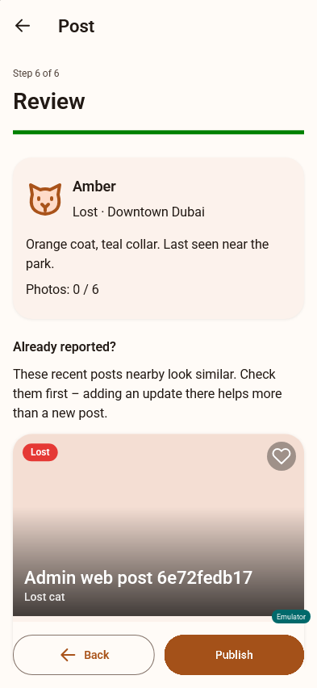

## Remaining visible differences

- Browser text shaping, font metrics, canvas wrapping and anti-aliasing differ from Compose/Android. The self-hosted fonts and explicit type weights match the chosen families; line breaks can still differ, especially with Arabic and large text.
- Generic back/search/settings controls use small inline SVGs and CSS state layers; their strokes and hover/focus/ripple behavior are not exact Material Android renders.
- Text fields have the same limits and labels but use a label above the outline rather than Compose's floating label animation. Select menus, date/time pickers, sliders and focus outlines use browser rendering; iOS itself needs a real-phone check.
- Bottom sheets use native HTML dialogs with a slide and close button. Their scrolling/drag behavior, modal scrim, handle and height differ from Compose's draggable sheets. Some filter chips are taller to retain 48px touch targets, so more rows wrap.
- The native references have different viewport/status-bar insets and sample records. Web shows an Emulator chip in local mode. Installed Safari safe areas cannot be verified by a desktop viewport.
- OpenFreeMap tile/glyph delivery depends on network access. A capture can show the initial map background while tiles load; tile labels/buildings and 3D perspective can differ with SDK/style revisions. These captures do not establish geographic pixel parity. Map data, filter/list behavior, marker categories, coat pins and selections use the native logic.
- Posters preserve native geometry and QR target rules, but browser/Android canvas text baselines, line wrapping and QR module rasterization differ. Safari uses a bounded font-load wait with system-font fallback if its font requests stall.
- List/dialog/administration spacing, chart labels, empty-state illustration sizes and control elevations are close CSS equivalents, not pixel-identical. Recognition has the explicit web-descriptor/ML Kit adaptation.
- Actual pinch, camera capture, share-sheet, install and geolocation presentation remain unverified on a real iPhone. Browser alert toasts replace Android system notifications; no background poll or push is implemented as specified.

The renderer set is review evidence. Visual parity remains subject to the owner's/Claude's comparison and real-device approval, and should not be described as exact 1:1.
